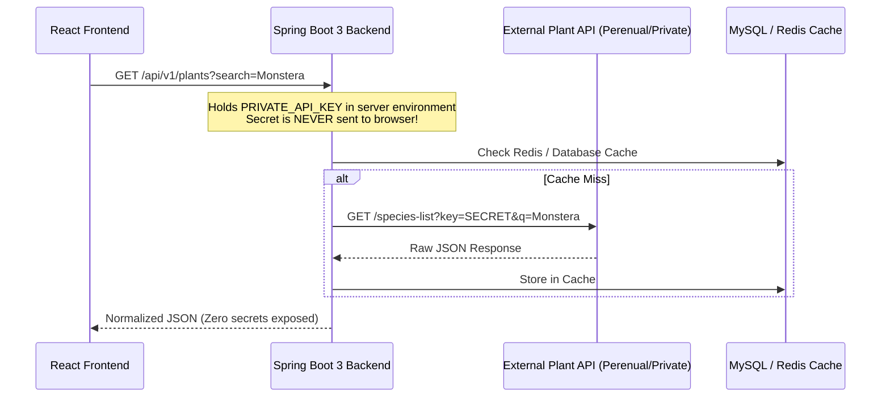

# Plantify — Personal Learning Notes
## Module 04: Real Plant API Integration, HTTP Networking & Security

### 1. Networking & Architectural Concepts Explained

#### A. What is a REST API?
* **API (Application Programming Interface):** A set of defined rules and URL endpoints that allows our React frontend to request data from external servers.
* **HTTP GET Request:** A message sent from the browser asking a server for resources (e.g. `GET https://api.inaturalist.org/v1/taxa?q=Monstera`).
* **Query Parameters (`?key=value&key2=value2`):** Arguments appended to the URL that tell the API how to filter or paginate results (e.g. `iconic_taxa=Plantae&per_page=12`).

#### B. Understanding `fetch()`, `async/await`, and Promises
1. **Promises:** A Promise represents an asynchronous operation that will finish in the future (either resolved with data or rejected with an error).
2. **`async / await`:** Modern JavaScript syntax that makes asynchronous Promise code read sequentially like regular synchronous code.
3. **The Two-Step `fetch` Process:**
   ```javascript
   // Step 1: Send HTTP request and wait for response headers
   const response = await fetch(url);
   
   // Step 2: Check if HTTP status is in the 200–299 range
   if (!response.ok) {
     throw new Error(`HTTP Error: ${response.status} ${response.statusText}`);
   }
   
   // Step 3: Stream and parse JSON body into a JavaScript object
   const data = await response.json();
   ```

#### C. Handling HTTP Status Codes & Network Errors
* `200 OK`: Request succeeded; JSON data is ready.
* `400 Bad Request`: Missing required parameter (e.g., Perenual without a `key`).
* `401 / 403 Unauthorized`: Invalid or missing credentials.
* `404 Not Found`: The requested resource or species does not exist.
* `429 Too Many Requests`: Rate limit reached.
* `500 Internal Server Error`: External server crashed.
* **Network / CORS Errors:** When an external server blocks cross-origin browser requests or your computer loses internet access. Our service catches these in a `try...catch` block and transitions to the fallback catalog.

#### D. The Data Normalization Pattern
* External APIs return completely different field names (e.g., iNaturalist uses `preferred_common_name` and `default_photo.medium_url`, while Perenual uses `common_name` and `default_image.regular_url`).
* Instead of polluting UI components with conditional checks, our `plantService.js` normalizes external payloads into one unified schema (`id`, `name`, `scientificName`, `price`, `rating`, `image`, `light`, `water`, `source`).
* **Benefit:** If we switch from iNaturalist to Spring Boot later, only `plantService.js` updates—not a single UI component is modified.

---

### 2. Security: Why Browser Frontends Cannot Safely Hold Private Secrets

#### The Danger of Client-Side API Keys:
* Any environment variable prefixed with `VITE_` (e.g., `VITE_PERENUAL_API_KEY`) is **bundled into plain-text JavaScript delivered to the user's browser**.
* Anyone can open DevTools (`F12`), check the Network tab or JavaScript bundle, and copy your API key.
* For paid APIs with rate limits, unauthorized users could exhaust your monthly quota or incur unauthorized charges.

#### The Production Solution (Phase 3: Java Spring Boot Backend Proxy):


---

### 3. API Evaluation Summary

* **Primary Provider: iNaturalist Biodiversity API**
  * **Documentation:** [iNaturalist API Documentation](https://api.inaturalist.org/v1/docs/)
  * **Endpoint:** `GET https://api.inaturalist.org/v1/taxa`
  * **Authentication:** **None required.**
  * **CORS Policy:** Wildcard (`Access-Control-Allow-Origin: *`) enabled.
  * **Data:** Verified plant species, common names, binomial nomenclature, observation counts, and real photography.

* **Optional Provider: Perenual Plant API**
  * **Documentation:** [Perenual API Docs](https://perenual.com/docs/api)
  * **Authentication:** Requires `key=...`.
  * **Configuration:** Configured via `VITE_PERENUAL_API_KEY` in `.env`.

---

### 4. Verification & Build Results

#### Production Build (`npm run build`)
* **Command:** `npm run build`
* **Result:**
  ```text
  vite v8.3.4 building client environment for production...
  transforming...
  ✓ 28 modules transformed.
  rendering chunks...
  computing gzip size...
  dist/index.html                   0.81 kB │ gzip:  0.47 kB
  dist/assets/index-0QKYtTWR.css   11.89 kB │ gzip:  3.02 kB
  dist/assets/index-BMUXUDK0.js   263.79 kB │ gzip: 79.57 kB
  ✓ built in 484ms
  ```
* **Exit Code:** `0` (Success, 0 errors).

#### Live API Verification
* **Live Query Tested:** `https://api.inaturalist.org/v1/taxa?q=Monstera&iconic_taxa=Plantae&rank=species`
* **Result:** Successfully returned `Monstera deliciosa` (Swiss Cheese Plant), `Epipremnum pinnatum`, and verified images from `static.inaturalist.org` with HTTP 200.
* **Dev Server Status:** `http://localhost:5174/` responding with `StatusCode: 200 OK`.
